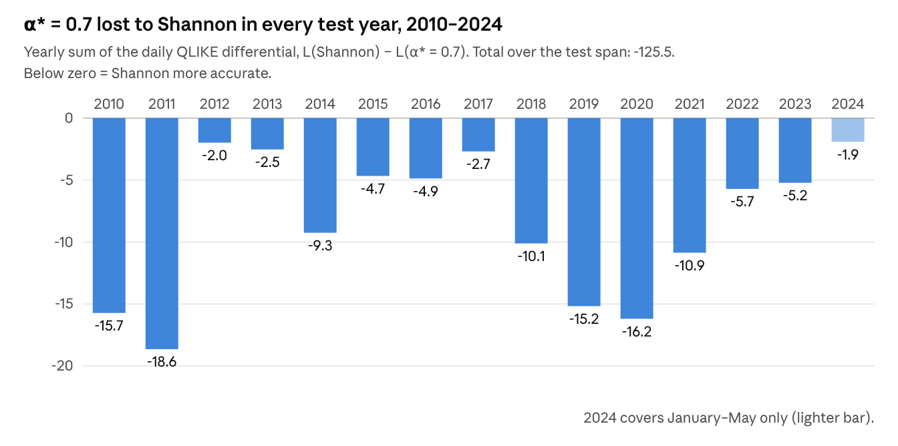

# Chapter IV — Results

The pre-registered confirmatory hypothesis is not supported. On the 2010–2024 test span, HR-ETE-GNN at the validation-selected order α\* = 0.7 produced a test QLIKE of 0.0693, against 0.0347 for the Shannon baseline H-ETE-GNN. The Giacomini–White test rejects equal predictive ability in favour of the baseline (p < 0.001). In the exploratory sensitivity analysis, every Rényi order below one was also less accurate than Shannon. The orders above one were more accurate: α = 1.5 reduced test QLIKE by 28.8% and was the only model retained in the 90% Model Confidence Set.

The chapter keeps two kinds of result apart. The **confirmatory** results (Sections 4.5 and 4.7) concern the single order α\* = 0.7, which was fixed on the validation span before any test-span forecast was evaluated. They carry Hypotheses H1a to H1d. The **exploratory** results (Sections 4.6, 4.8 and 4.9) concern the remaining orders, α ∈ {0.5, 0.9, 1.5, 2.0}. They are reported as a sensitivity analysis, with p-values adjusted for multiplicity, and are not read as confirmation of any hypothesis.

Section 4.1 describes the experimental run, 4.2 the data and the Hurst regime calendar, 4.3 the selection of α\*, and 4.4 the replication audit against Lee and Cho (2025). Sections 4.5 to 4.9 report the tests, and Section 4.10 summarises the findings. Research Question 2, on network topology, is not tested by these runs. Section 4.9 reports only the graph-density diagnostic needed to interpret the Research Question 1 results.

## 4.1 Experimental run and reproducibility

Six models were each trained over the full walk-forward with 10 random seeds, giving 60 runs in total. The models are the Shannon baseline (α = 1) and HR-ETE-GNN at α ∈ {0.5, 0.7, 0.9, 1.5, 2.0}. Apart from the Rényi order used to build the edge matrix, every element of the pipeline was identical across models:

- the frozen data panel;
- the discretised transfer-entropy estimator (three bins, k = l = 1, m = 100 shuffled surrogates, edges retained at Z > 1.96);
- the architecture, the training budget and the Hurst retraining calendar;
- the seed list and the surrogate permutations.

At α = 1 the Rényi edge builder calls the baseline's own effective transfer entropy code, so the two arms are nested exactly.

Each run forecasts one-day-ahead realised volatility for the ten country ETFs on every trading day from 29 March 2006 to 29 May 2024, 4,573 days in total. Of these, 948 days up to 31 December 2009 form the validation span. The remaining 3,625 days, 4 January 2010 to 29 May 2024, form the test span on which all hypotheses are evaluated. Within each run the model was trained once and then fine-tuned at each of the 41 Hurst regime changes inside the forecast window, 42 fits in all.

All 60 runs used PyTorch's deterministic mode on a single NVIDIA GeForce RTX 2070. In this mode the same model, seed and data produce bit-identical forecasts on every rerun. The setting was adopted after a check showed that the default GPU kernels are not reproducible. Three reruns of the same Shannon model and seed on the validation span gave validation MSEs of 0.912, 1.369 and 1.410. Under deterministic mode, two reruns agreed to the last bit. Unless stated otherwise, every test statistic in this chapter is computed on the **seed ensemble**: the mean of the ten seeds' forecasts for each model, which removes initialisation noise from the comparison.

## 4.2 Data and the Hurst regime calendar

The sample covers 5,363 trading days, from 7 February 2003 to 29 May 2024, for ten iShares country ETFs. They are EWA (Australia), EWC (Canada), EWG (Germany), EWJ (Japan), EWT (Taiwan), EWU (United Kingdom), EWW (Mexico), EWY (South Korea), EWZ (Brazil) and EZA (South Africa). Realised volatility was computed over a 20-day window. The panel was downloaded once and frozen, so every run read identical data.

The regime proxy is the MSCI World ETF (URTH), spliced with IOO and ACWI where URTH has no history: 3,113 days come from URTH, 1,292 from IOO and 957 from ACWI. The rolling Hurst exponent uses a 250-day window and the literal rescaled-range estimator, with no small-sample correction. Its mean over the sample is 0.539, and 80.7% of days have H ≥ 0.5. With a regime look-back of 10 days and a sensitivity of 6, the procedure produced 50 regime changes over the full sample, against 47 reported by Lee and Cho (2025).

On the test span the lagged regime indicator classifies 2,907 days (80.2%) as persistent (H ≥ 0.5) and 718 days (19.8%) as anti-persistent (H < 0.5). The regime-conditional test of H1b (Section 4.7) uses this indicator as its instrument.

## 4.3 Selection of α\* on the validation span

The validation span selected α\* = 0.7, which had the lowest mean validation MSE. MSE is the training loss. Each candidate in the grid {0.7, 0.9, 1.0, 1.5, 2.0} was run over the validation span with three seeds. Orders below 0.6 were excluded from selection (Section 3.5; Limitation 2), so α = 0.5 was not a candidate. α\* was frozen before any test-span forecast was evaluated.

**Table 4.1.** Validation-span results by Rényi order (forecast days up to 31 December 2009; three seeds).

| α | Validation MSE, mean (SD) | Validation QLIKE, mean | Selected |
|---|---|---|---|
| 0.7 | 0.827 (0.159) | 0.155 | α\* |
| 0.9 | 1.063 (0.317) | 0.155 | |
| 1.0 (Shannon) | 1.165 (0.599) | 0.185 | |
| 1.5 | 1.479 (1.569) | 0.131 | |
| 2.0 | 0.929 (0.244) | 0.136 | |

The differences between orders are small relative to their seed-to-seed spread, and every standard deviation overlaps at least one other order's mean. The ranking also depends on the loss: on validation QLIKE, which played no part in the selection, α = 1.5 ranks first and α = 0.7 third. The selection runs were made before deterministic mode was adopted (Section 4.1), so they carry additional run-to-run noise of the size reported there. These runs are kept unchanged as the record of how α\* was chosen.

## 4.4 Replication audit against Lee and Cho (2025)

The replicated baseline does not reach the accuracy Lee and Cho (2025) report for H-ETE-GNN. Over the full forecast window its RMSE is 0.609 against their 0.162, its correlation 0.866 against 0.961, and its hit ratio 0.553 against 0.721. Table 4.2 sets out the paper's five metrics for every model, laid out like Lee and Cho's Table 6. Each metric is computed per seed over all 4,573 forecast days (2006–2024, including the validation years), then averaged over the ten seeds.

**Table 4.2.** Full-span forecast accuracy, mean ± SD over 10 seeds (29 March 2006 – 29 May 2024).

| Model | RMSE | MAE | MAPE (%) | Correlation | Hit ratio | QLIKE |
|---|---|---|---|---|---|---|
| H-ETE-GNN (α = 1) | 0.609 ± 0.171 | 0.237 ± 0.024 | 13.20 ± 0.70 | 0.866 ± 0.022 | 0.553 ± 0.002 | 0.135 ± 0.160 |
| HR-ETE-GNN, α = 0.5 | 0.586 ± 0.052 | 0.287 ± 0.008 | 17.41 ± 0.27 | 0.842 ± 0.024 | 0.536 ± 0.003 | 2.460 ± 3.611 |
| HR-ETE-GNN, α\* = 0.7 | 0.647 ± 0.105 | 0.290 ± 0.013 | 17.45 ± 0.38 | 0.814 ± 0.060 | 0.537 ± 0.002 | 7.686 ± 12.318 |
| HR-ETE-GNN, α = 0.9 | 0.648 ± 0.175 | 0.276 ± 0.017 | 15.97 ± 0.52 | 0.833 ± 0.039 | 0.542 ± 0.002 | 5.504 ± 5.973 |
| HR-ETE-GNN, α = 1.5 | 0.621 ± 0.190 | 0.216 ± 0.023 | 12.04 ± 0.52 | 0.869 ± 0.039 | 0.558 ± 0.003 | 0.364 ± 0.855 |
| HR-ETE-GNN, α = 2.0 | 0.744 ± 0.239 | 0.239 ± 0.021 | 13.08 ± 0.46 | 0.838 ± 0.046 | 0.554 ± 0.004 | 1.039 ± 2.753 |
| Lee and Cho (2025), H-ETE-GNN | 0.162 | 0.102 | 6.66 | 0.961 | 0.721 | – |

The gap to the published figures is common to all six models, so it does not bear on the within-study comparison, which holds every setting fixed except α. It is consistent with the specification gaps that the thesis had to fill (Section 3.5), and the comparison in this chapter is between the arms as implemented here.

On the paper's metrics the orders split into two groups. α = 1.5 is the most accurate model on MAE, MAPE, correlation and hit ratio. The orders below one are the least accurate on MAE, MAPE and hit ratio. Their per-seed QLIKE has a mean far above its median, because a minority of seeds produce very large losses; Section 4.9 traces these losses to non-positive forecasts. α = 0.5 has the lowest mean RMSE, but its MAE and MAPE are among the worst, so the low RMSE does not reflect better forecasts overall.

## 4.5 Confirmatory test: HR-ETE-GNN (α\* = 0.7) against H-ETE-GNN

Hypothesis H1a is not supported. Over the 3,625 test days the seed-ensemble QLIKE of HR-ETE-GNN (α\* = 0.7) is 0.0693, against 0.0347 for H-ETE-GNN, an increase in loss of 99.9%. The loss differential is defined as dₜ = Lₜ(H-ETE-GNN) − Lₜ(HR-ETE-GNN), averaged over the ten ETFs, so a positive dₜ means the Rényi model won day t. Its mean is negative. The one-sided Giacomini–White test of H1a therefore has p = 1.000. The two-sided form rejects equal predictive ability (Wald = 392.8, p < 0.001), and the rejection is in favour of the Shannon baseline.

**Table 4.3.** Confirmatory test of H1a, test span 4 January 2010 – 29 May 2024 (3,625 days, seed-ensemble forecasts).

| Quantity | Value |
|---|---|
| QLIKE, H-ETE-GNN | 0.0347 |
| QLIKE, HR-ETE-GNN (α\* = 0.7) | 0.0693 |
| Change in QLIKE (positive = Rényi better) | −99.9% |
| Giacomini–White Wald statistic | 392.8 |
| Giacomini–White p, two-sided | < 0.001 |
| Giacomini–White p, one-sided (H1a) | 1.000 |
| Diebold–Mariano (HLN) statistic on QLIKE | −48.77 |
| Diebold–Mariano p, one-sided | 1.000 |
| Change in MSE (positive = Rényi better) | −19.6% |
| Diebold–Mariano p on MSE, one-sided | 0.997 |
| **Decision on H1a (5%)** | **Fail to reject H₀; Shannon significantly more accurate** |

The secondary loss gives the same answer: MSE is 19.6% higher for the Rényi model. The Diebold–Mariano statistics are reported as descriptive only, because the two models are nested and the test is undersized in that case.

The result is not driven by a few seeds or a single market. Taken one seed at a time, HR-ETE-GNN (α\* = 0.7) had a higher test QLIKE than H-ETE-GNN in all 10 seeds. Table 4.4 reports the per-ETF tests of H1c.

**Figure 4.1.** Yearly sum of the daily QLIKE differential between H-ETE-GNN and HR-ETE-GNN (α\* = 0.7), seed-ensemble forecasts. The deficit appears in all 15 years and is largest in 2010–2011 and 2019–2020.

**Table 4.4.** Per-ETF test of H1c: one-sided Diebold–Mariano on QLIKE with Benjamini–Hochberg control at q = 0.10.

| ETF | QLIKE, H-ETE-GNN | QLIKE, HR-ETE-GNN (α\* = 0.7) | Change | DM statistic | BH-adjusted p | Rényi better? |
|---|---|---|---|---|---|---|
| EWA | 0.0237 | 0.0443 | −87.0% | −13.16 | 1.000 | No |
| EWC | 0.0241 | 0.1085 | −349.5% | −35.38 | 1.000 | No |
| EWG | 0.0509 | 0.0474 | +6.9% | 4.21 | < 0.001 | **Yes** |
| EWJ | 0.0213 | 0.0719 | −237.8% | −33.10 | 1.000 | No |
| EWT | 0.0261 | 0.0490 | −87.4% | −25.51 | 1.000 | No |
| EWU | 0.0321 | 0.0405 | −26.0% | −11.31 | 1.000 | No |
| EWW | 0.0231 | 0.0344 | −48.5% | −10.91 | 1.000 | No |
| EWY | 0.0174 | 0.0621 | −256.9% | −29.68 | 1.000 | No |
| EWZ | 0.1006 | 0.1025 | −1.8% | −0.56 | 1.000 | No |
| EZA | 0.0272 | 0.1324 | −387.6% | −21.22 | 1.000 | No |

H₀ of H1c is rejected for one ETF, Germany (EWG), where the Rényi model reduced QLIKE by 6.9%. For the other nine ETFs the differential is negative, with losses ranging from 1.8% (Brazil) to 387.6% (South Africa). A single significant market out of ten, against nine in the opposite direction, does not support a general Rényi advantage.

## 4.6 Sensitivity across Rényi orders

The sign of the result depends on which side of one the Rényi order lies. All three orders below one are significantly less accurate than Shannon. Both orders above one are significantly more accurate. These comparisons are exploratory: only α\* = 0.7 was fixed in advance. To allow for testing five orders against the same baseline, the one-sided Giacomini–White p-values are adjusted with the Holm procedure across all five.

**Table 4.5.** Each Rényi order against H-ETE-GNN on the test span (seed-ensemble forecasts). H₀: equal predictive ability; H₁: lower QLIKE for the Rényi model. H-ETE-GNN's test QLIKE is 0.0347.

| α | Role | QLIKE | Change in QLIKE | GW Wald | GW p, two-sided | GW p, one-sided | Holm p | Change in MSE | ETFs better (BH) | Seeds better | Decision (5%) |
|---|---|---|---|---|---|---|---|---|---|---|---|
| 0.5 | Sensitivity | 0.0659 | −90.3% | 427.7 | < 0.001 | 1.000 | 1.000 | −23.9% | 2/10 | 2/10 | Fail to reject; Shannon better |
| 0.7 | Confirmatory (α\*) | 0.0693 | −99.9% | 392.8 | < 0.001 | 1.000 | 1.000 | −19.6% | 1/10 | 0/10 | Fail to reject; Shannon better |
| 0.9 | Sensitivity | 0.0589 | −70.1% | 130.5 | < 0.001 | 1.000 | 1.000 | −28.7% | 0/10 | 1/10 | Fail to reject; Shannon better |
| 1.5 | Sensitivity | 0.0247 | +28.8% | 74.0 | < 0.001 | < 0.001 | < 0.001 | +7.5% | 8/10 | 6/10 | Reject H₀; Rényi better |
| 2.0 | Sensitivity | 0.0316 | +8.8% | 6.7 | 0.010 | 0.005 | 0.020 | −79.4% | 5/10 | 5/10 | Reject H₀; Rényi better |

α = 1.5 is the strongest result. It reduces QLIKE by 28.8% and MSE by 7.5%, and it is significantly better in 8 of the 10 ETFs after Benjamini–Hochberg correction. The two ETFs where it loses are South Korea (EWY, −92.1%) and South Africa (EZA, −1.3%, not significant). α = 2.0 is better on QLIKE by 8.8% (Holm p = 0.020) but worse on MSE by 79.4%: it is more accurate on most days but makes much larger errors on high-volatility days, which MSE weights heavily.

The Model Confidence Set (Table 4.6) tests H1d. Because the benchmark models were not run in this experiment, to save compute, the candidate set here is the six models of this chapter, not the full list in H1d. The set was built from the daily QLIKE of the seed-ensemble forecasts, at 90% confidence with 1,000 stationary-bootstrap resamples.

**Table 4.6.** 90% Model Confidence Set on test-span QLIKE.

| Model | Test QLIKE | MCS p-value | In the 90% set |
|---|---|---|---|
| HR-ETE-GNN, α = 1.5 | 0.0247 | 1.000 | Yes |
| HR-ETE-GNN, α = 2.0 | 0.0316 | 0.001 | No |
| H-ETE-GNN (α = 1) | 0.0347 | 0.001 | No |
| HR-ETE-GNN, α = 0.9 | 0.0589 | < 0.001 | No |
| HR-ETE-GNN, α = 0.5 | 0.0659 | < 0.001 | No |
| HR-ETE-GNN, α\* = 0.7 | 0.0693 | < 0.001 | No |

The 90% set contains HR-ETE-GNN at α = 1.5 alone and excludes the Shannon baseline. The H1d decision rule ("contains HR-ETE-GNN and excludes H-ETE-GNN") is met, but only by an order that was not selected on validation. The confirmatory order α\* = 0.7 is eliminated, so H1d is supported in its exploratory form only.

## 4.7 Regime-conditional test (H1b)

Hypothesis H1b is not supported. If H1b held, the Rényi model's advantage would be larger on days that follow an anti-persistent (H < 0.5) regime signal. The conditional Giacomini–White regression of dₜ on a constant and the lagged anti-persistent indicator gives a coefficient of −0.0029 for α\* = 0.7 (t = −0.89, one-sided p = 0.812). The sign is the opposite of the hypothesis: the Rényi model's loss deficit is slightly larger after anti-persistent signals (mean dₜ = −0.0369) than after persistent ones (−0.0341). The joint conditional test is significant (Wald = 413.0, p < 0.001), but this reflects the overall deficit in the constant term, not a regime effect.

**Table 4.7.** Regime-conditional Giacomini–White regressions on the test span. The instrument is coded 1 on days following an anti-persistent signal, so a positive coefficient supports H1b; with the opposite coding the sign reverses.

| α | Role | Mean dₜ, persistent days | Mean dₜ, anti-persistent days | Coefficient on anti-persistent indicator (t) | One-sided p |
|---|---|---|---|---|---|
| 0.5 | Sensitivity | −0.0297 | −0.0379 | −0.0082 (−3.16) | 0.999 |
| 0.7 | Confirmatory (α\*) | −0.0341 | −0.0369 | −0.0029 (−0.89) | 0.812 |
| 0.9 | Sensitivity | −0.0264 | −0.0158 | +0.0106 (+3.20) | 0.001 |
| 1.5 | Sensitivity | +0.0105 | +0.0079 | −0.0026 (−1.30) | 0.903 |
| 2.0 | Sensitivity | +0.0029 | +0.0039 | +0.0010 (+0.51) | 0.306 |

Among the exploratory orders, only α = 0.9 shows the hypothesised pattern (coefficient +0.0106, one-sided p = 0.001). Even there the Rényi model still loses on anti-persistent days (mean dₜ = −0.0158); its deficit is only narrower than on persistent days. The best-performing order, α = 1.5, gains more on persistent days (+0.0105) than on anti-persistent ones (+0.0079). Across orders, then, the Rényi effect does not concentrate in the anti-persistent regime that H1b associates with turbulence.

## 4.8 Robustness of the comparison

The direction of every comparison holds under four robustness checks. The Giacomini–White test treats each model's seed-ensemble forecast as fixed, so it does not capture uncertainty about which ten seeds were drawn. Table 4.8 adds three checks for that uncertainty:

- **Seed bootstrap.** The ten seeds were resampled with replacement 2,000 times, using the same draw for both models. The ensemble differential d̄ = QLIKE(H-ETE-GNN) − QLIKE(Rényi) was recomputed for each draw.
- **Leave one seed out.** Each seed was dropped in turn, and the percentage change in QLIKE was recomputed on the remaining nine.
- **Median ensemble.** The median of the ten seeds' forecasts replaced the mean.

**Table 4.8.** Robustness of the test-span comparison with H-ETE-GNN (positive d̄ = Rényi better). For reference, H-ETE-GNN's QLIKE is 0.0347 with the mean ensemble and 0.0344 with the median ensemble.

| α | d̄ (point) | Seed-bootstrap 95% interval | Share of resamples with Rényi better | Leave-one-seed-out change in QLIKE | QLIKE, median ensemble |
|---|---|---|---|---|---|
| 0.5 | −0.0313 | [−0.4487, −0.0292] | 0.0% | −94.1% to −87.8% | 0.0681 |
| 0.7 (α\*) | −0.0346 | [−2.0474, −0.0308] | 0.0% | −105.7% to −95.1% | 0.0707 |
| 0.9 | −0.0243 | [−0.8444, −0.0212] | 0.0% | −75.4% to −66.4% | 0.0607 |
| 1.5 | +0.0100 | [+0.0074, +0.0131] | 100.0% | +26.8% to +31.2% | 0.0262 |
| 2.0 | +0.0031 | [−0.0000, +0.0061] | 97.5% | +6.3% to +9.8% | 0.0322 |

The intervals for the orders below one lie entirely below zero, and the one for α = 1.5 lies entirely above it. The interval for α = 2.0 touches zero, so its advantage is the least secure of the significant results. The long lower tails for α < 1 come from resamples that repeat the few seeds with extreme losses (Section 4.9). No single seed changes any conclusion, and the median ensemble gives the same ranking as the mean ensemble.

The advantage of α = 1.5 is a property of the ensemble rather than of a typical single model. Its median single-seed test QLIKE (0.0594) is close to Shannon's (0.0571), and it beats Shannon in 6 of the 10 seeds.

The fourth check concerns reproducibility. The two models first compared in an earlier, non-deterministic run (Section 4.1) give the same conclusion under deterministic mode: the ensemble QLIKE moved from 0.0358 to 0.0347 for H-ETE-GNN and from 0.0682 to 0.0693 for α\* = 0.7.

## 4.9 Diagnostics: graph density and non-positive forecasts

The Rényi order changed how many edges survived the Z > 1.96 surrogate screen, not only how they were weighted. Table 4.9 reports the edge counts on 11 of the 42 refit windows (every fourth window, seed 0), out of 90 possible directed edges. At α = 0.5 and α = 0.7 the screen kept a mean of 1.2 and 2.4 edges, and no edges at all in 6 of the 11 windows. With an empty adjacency matrix the neighbourhood term of every GCN layer is zero, so in those windows HR-ETE-GNN forecasts each ETF from its own history alone. Shannon kept 16.4 edges on average, and α = 1.5 kept the most, 20.5.

**Table 4.9.** Edge counts and forecast pathologies by Rényi order. Edges are counted on 11 refit windows; the other columns cover all 10 seeds on the test span (362,500 forecasts per model).

| α | Mean edges kept (min–max) | Windows with no edges | Forecasts below the QLIKE floor (0.05) | Seeds with test QLIKE > 1 | Median single-seed test QLIKE |
|---|---|---|---|---|---|
| 0.5 | 1.2 (0–6) | 6 of 11 | 78 | 6 | 1.765 |
| 0.7 (α\*) | 2.4 (0–10) | 6 of 11 | 179 | 6 | 1.912 |
| 0.9 | 6.7 (0–29) | 2 of 11 | 136 | 7 | 4.678 |
| 1.0 (Shannon) | 16.4 (3–38) | 0 of 11 | 16 | 0 | 0.057 |
| 1.5 | 20.5 (2–51) | 0 of 11 | 17 | 1 | 0.059 |
| 2.0 | 14.5 (1–41) | 0 of 11 | 28 | 1 | 0.058 |

The orders below one also produced many more volatility forecasts at or below zero. The output layer is linear and unconstrained, and QLIKE is defined only for positive forecasts, so forecasts below 0.05 are clipped to 0.05 before scoring. Each clipped forecast then incurs a very large loss. Across the ten seeds α\* = 0.7 produced 179 such forecasts, against 16 for Shannon, the lowest being −27.8. Six or seven of the ten seeds at each order below one have a test QLIKE above 1, against none for Shannon. MSE, which applies no clipping, is also 19.6% to 28.7% worse for these orders (Table 4.5), so the clipping magnifies their disadvantage but does not create it.

The two diagnostics move together. The sparsest graphs, at α < 1, coincide with the most frequent non-positive forecasts and the largest losses, and the densest graph, at α = 1.5, coincides with the best forecasts. The comparison across orders therefore varies two things at once: the entropy used to weight an edge and the number of edges retained. The design of this experiment cannot separate the two.

## 4.10 Summary of findings

None of the confirmatory hypotheses for α\* = 0.7 is supported. Two exploratory results stand out: Rényi orders above one outperformed Shannon, and the Rényi order changed graph density.

**Table 4.10.** Summary of hypothesis decisions (test span 2010–2024, 5% level unless stated).

| Hypothesis | Test | Result for α\* = 0.7 | Decision |
|---|---|---|---|
| H1a: lower expected loss than H-ETE-GNN | One-sided Giacomini–White on QLIKE | QLIKE −99.9%; one-sided p = 1.000; two-sided p < 0.001 in favour of Shannon | Not supported; the baseline is significantly better |
| H1b: larger gain after anti-persistent signals | Conditional GW, lagged regime instrument | Coefficient −0.0029; one-sided p = 0.812 | Not supported |
| H1c: gain in at least one ETF | Per-ETF DM, Benjamini–Hochberg q = 0.10 | Better in EWG only (+6.9%); worse in the other nine | Supported for one ETF only |
| H1d: in the 90% MCS, baseline excluded | Model Confidence Set over six models | Set = {α = 1.5}; α\* and Shannon excluded | Met only by a non-selected order |

The exploratory results across orders are as follows:

1. Every order below one (α = 0.5, 0.7, 0.9) was significantly less accurate than Shannon, by 70% to 100% in QLIKE.
2. α = 1.5 was more accurate than Shannon by 28.8% in QLIKE and 7.5% in MSE (Holm p < 0.001). It was better in 8 of 10 ETFs and was the only model in the 90% MCS. The result held under the seed bootstrap and leave-one-seed-out checks.
3. α = 2.0 was more accurate on QLIKE (+8.8%, Holm p = 0.020) but much less accurate on MSE (−79.4%), and its seed-bootstrap interval touches zero.
4. No order showed a larger gain after anti-persistent regime signals.
5. Orders below one kept almost no edges through the surrogate screen and produced the most non-positive forecasts, so the effect of α cannot be separated from the effect of graph density.

Because α = 1.5 was not selected on the validation span, its advantage is a finding for further testing, not a confirmed result. Chapter V discusses what these results imply for the thesis's argument that tail-sensitive (α < 1) measurement improves forecasting, and how a density-matched design could separate the two effects.
